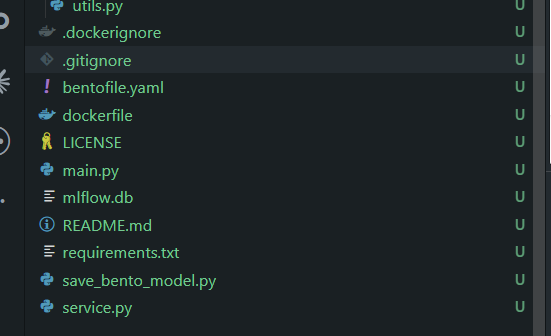
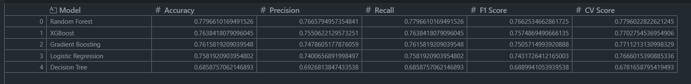
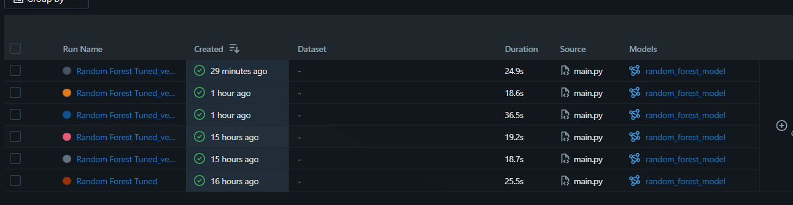
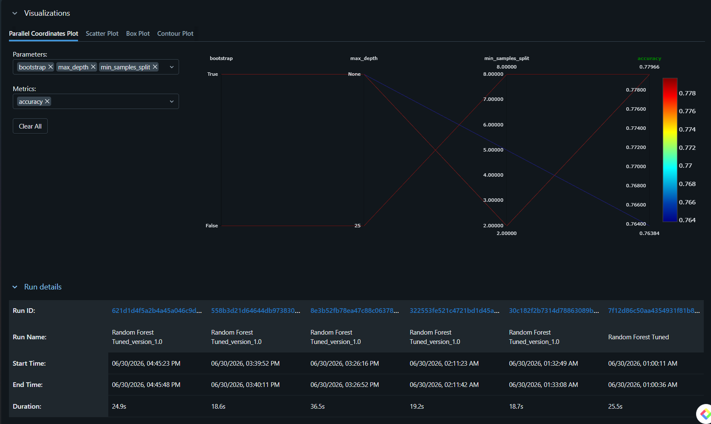
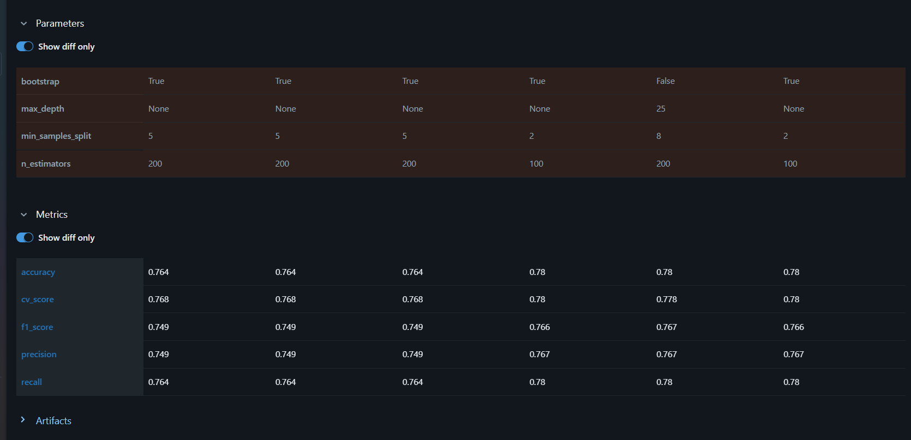
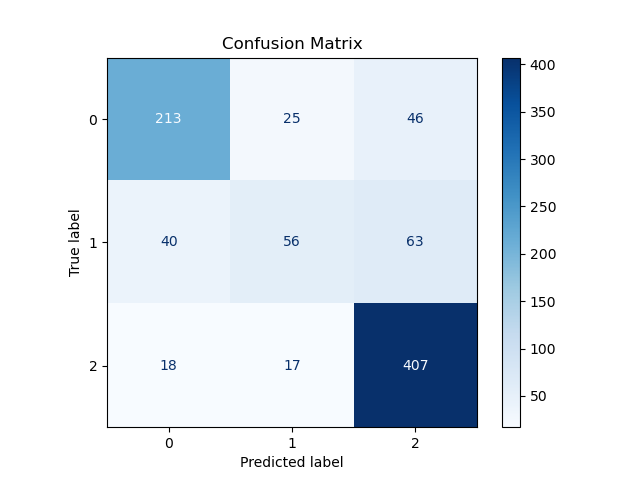
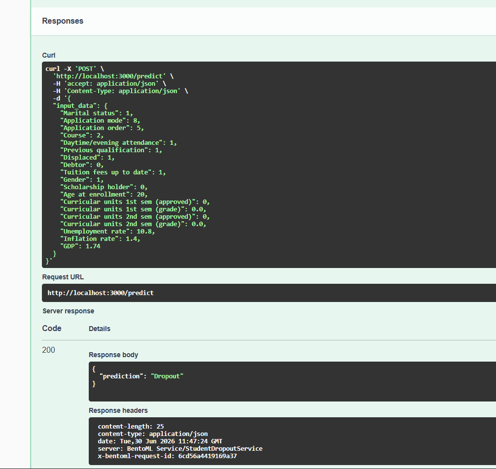
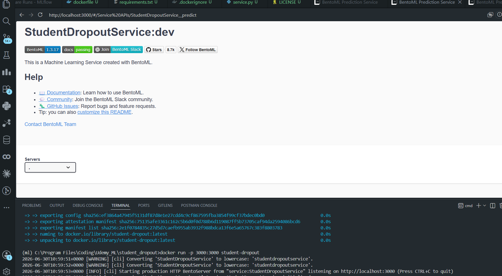

<h1 align="center">
Student Dropout Prediction
</h1>

<p align="center">
A production-oriented Machine Learning project that predicts whether a student is likely to <b>Graduate</b>, <b>Dropout</b>, or remain <b>Enrolled</b> using academic performance, demographic characteristics, and socioeconomic factors.
</p>

<p align="center">


</p>

## Project Snapshot 
---

| Item | Details |
|------|---------|
| Problem Type | Multi-Class Classification |
| Dataset | Student Dropout & Academic Success |
| Target Classes | Graduate, Dropout, Enrolled |
| Best Model | Random Forest |
| Accuracy | 76.38% |
| Experiment Tracking | MLflow |
| Model Serving | BentoML |
| Deployment | Docker |
| API | REST (Swagger/OpenAPI) |


---

## Overview

Student dropout is a major challenge faced by educational institutions. Detecting students who are at risk early enables universities to provide timely academic support, improve retention rates, and make better data-driven decisions.

This repository demonstrates how a Machine Learning model can be taken beyond experimentation into a deployment-ready application. The project covers the complete lifecycle of an ML solution—from raw data preprocessing to model serving—using modern MLOps practices.

Unlike a traditional notebook-based project, every stage of the workflow has been modularized, tracked, versioned, and prepared for deployment.

---

## Key Highlights

- End-to-end Machine Learning pipeline
- Modular project architecture
- Centralized feature management
- Multiple baseline model comparison
- Hyperparameter tuning using GridSearchCV
- Experiment tracking with MLflow
- Model serialization using Joblib
- REST API deployment with BentoML
- Docker containerization
- Interactive API documentation (Swagger/OpenAPI)

---

## Project Objectives

The primary objective of this project is to build a deployment-ready machine learning system capable of predicting student academic outcomes.

The project focuses on three major aspects:

- Building an accurate prediction model.
- Following software engineering best practices for maintainability.
- Demonstrating an end-to-end MLOps workflow suitable for production environments.

The final model predicts one of the following academic outcomes:

| Prediction Classes |
|--------------------|
| Graduate |
| Dropout |
| Enrolled |

---

# System Architecture

The following architecture illustrates the complete workflow implemented in this project.

<p align="center">

</p>

The pipeline follows a modular approach where each stage is isolated into its own component.

```
Raw Dataset
      │
      ▼
Data Cleaning
      │
      ▼
Feature Selection
      │
      ▼
Preprocessing
      │
      ▼
Train-Test Split
      │
      ▼
Model Training
      │
      ▼
Hyperparameter Tuning
      │
      ▼
Model Evaluation
      │
      ▼
MLflow Tracking
      │
      ▼
BentoML Model Store
      │
      ▼
REST API
      │
      ▼
Docker Container
```

This separation allows each stage of the pipeline to be developed, tested, and maintained independently while improving readability and scalability.

---

# Project Features

The project has been designed as a complete Machine Learning workflow rather than a standalone prediction model.

| Feature | Description |
|----------|-------------|
| Data Preprocessing | Handles feature preparation before training |
| Feature Selection | Uses the final optimized feature subset |
| Model Comparison | Trains and compares multiple ML algorithms |
| Hyperparameter Tuning | Optimizes Random Forest using GridSearchCV |
| Cross Validation | Evaluates model robustness |
| MLflow Integration | Tracks experiments, metrics, and parameters |
| Model Serialization | Saves trained models and preprocessing pipeline |
| BentoML Deployment | Serves the trained model as a REST API |
| Docker Support | Deploys the complete application inside a container |

---

# Technology Stack

<p align="center">


</p>

| Technology | Purpose |
|------------|---------|
| Python | Core programming language |
| Scikit-learn | Model training, preprocessing, evaluation, and hyperparameter tuning |
| Pandas | Data loading and preprocessing |
| NumPy | Numerical computations |
| MLflow | Experiment tracking and model management |
| BentoML | Model serving through REST APIs |
| Docker | Containerization and deployment |
| Joblib | Model serialization |
| Git & GitHub | Version control and collaboration |

---
# Project Structure

A well-organized project structure is essential for maintaining, extending, and deploying machine learning applications. Instead of implementing the entire workflow in a single notebook, this project follows a modular architecture where each component has a clearly defined responsibility.

The following directory structure illustrates how the project is organized.

<p align="center">


</p>

### Directory Overview

| Directory / File | Purpose |
|------------------|---------|
| **data/** | Stores the original dataset used for training and evaluation. |
| **artifacts/** | Contains generated outputs such as evaluation metrics and experiment artifacts. |
| **models/** | Stores the trained model, preprocessing pipeline, and label encoder. |
| **src/** | Contains the complete machine learning pipeline divided into reusable modules. |
| **service.py** | Defines the BentoML inference service and prediction endpoint. |
| **main.py** | Executes the complete training pipeline from data loading to model serialization. |
| **save_bento_model.py** | Registers the trained model into the BentoML Model Store. |
| **bentofile.yaml** | Configuration file required for BentoML packaging and deployment. |
| **Dockerfile** | Defines the Docker image used to containerize the application. |
| **requirements.txt** | Lists all project dependencies required to reproduce the environment. |

This modular design improves code readability, promotes reusability, and allows each stage of the pipeline to evolve independently without affecting the rest of the project.

---

# Dataset

This project uses the **Student Dropout and Academic Success Dataset** available from the **UCI Machine Learning Repository**.

The dataset contains academic, demographic, and socioeconomic information collected from students enrolled in higher education institutions. The objective is to predict the final academic outcome of each student based on these attributes.

### Target Classes

The prediction model classifies each student into one of the following categories.

| Class | Description |
|--------|-------------|
| Graduate | The student successfully completed the academic program. |
| Dropout | The student discontinued the academic program before completion. |
| Enrolled | The student is still enrolled and has not yet graduated or dropped out. |

### Dataset Characteristics

| Property | Value |
|----------|-------|
| Learning Type | Supervised Multi-Class Classification |
| Number of Classes | 3 |
| Target Variable | Target |
| Input Features | Academic, Demographic and Socioeconomic Attributes |

The original dataset contains a large number of variables describing different aspects of a student's educational background and academic performance. During experimentation, feature importance and domain understanding were used to select the most relevant attributes for the final model.

---

# Feature Engineering

Feature engineering plays a significant role in improving model performance. Rather than training on every available attribute, a subset of informative features was selected to reduce noise, simplify the inference pipeline, and improve generalization.

The final model is trained using the following nineteen features.

| Selected Features |
|-------------------|
| Marital status |
| Application mode |
| Application order |
| Course |
| Daytime/evening attendance |
| Previous qualification |
| Displaced |
| Debtor |
| Tuition fees up to date |
| Gender |
| Scholarship holder |
| Age at enrollment |
| Curricular units 1st semester (approved) |
| Curricular units 1st semester (grade) |
| Curricular units 2nd semester (approved) |
| Curricular units 2nd semester (grade) |
| Unemployment rate |
| Inflation rate |
| GDP |

The selected features capture both the academic progress of the student and external socioeconomic conditions, providing the model with sufficient information to distinguish between graduation, dropout, and continued enrollment.

To improve maintainability, the selected feature list is stored in a dedicated module (`src/features.py`). This ensures that the training pipeline, preprocessing stage, and prediction service always use an identical feature set, eliminating inconsistencies between training and inference.

---

# Data Preprocessing

Raw educational datasets often contain categorical attributes, numerical variables with different scales, and target labels represented as text. Before model training, the data undergoes a preprocessing pipeline to transform it into a format suitable for machine learning algorithms.

The preprocessing pipeline performs the following operations:

- Selection of the final feature subset.
- Separation of input features and target labels.
- Label encoding of the target variable.
- Feature scaling for numerical attributes.
- Stratified train-test split to preserve class distribution.

The fitted preprocessing objects are serialized using **Joblib** and reused during inference. This guarantees that incoming data is transformed using exactly the same preprocessing steps applied during training, ensuring consistent predictions in production.

---

# Machine Learning Workflow

The complete workflow implemented in this project follows a systematic sequence from raw data to deployment-ready model.

```
Load Dataset
      │
      ▼
Feature Selection
      │
      ▼
Data Preprocessing
      │
      ▼
Train-Test Split
      │
      ▼
Train Multiple Models
      │
      ▼
Evaluate Performance
      │
      ▼
Hyperparameter Tuning
      │
      ▼
Select Best Model
      │
      ▼
Save Model
      │
      ▼
Register with BentoML
      │
      ▼
Deploy REST API
      │
      ▼
Docker Container
```

Following a structured workflow ensures that every stage of the project is reproducible, modular, and easy to maintain. It also makes experimentation significantly easier, as changes introduced in one stage do not require rewriting the rest of the pipeline.

---
# Model Training

Model development began by training several widely used machine learning algorithms to establish baseline performance. Rather than selecting a single model immediately, multiple classifiers were evaluated using the same training and testing pipeline to identify the most suitable algorithm for the dataset.

The following models were implemented and evaluated:

- Logistic Regression
- Decision Tree
- Random Forest
- Gradient Boosting
- XGBoost

Each model was trained using identical preprocessing steps to ensure a fair comparison. Performance was evaluated using multiple metrics instead of relying solely on accuracy.

The evaluation metrics included:

- Accuracy
- Precision
- Recall
- F1-Score
- Cross-Validation Score

Using multiple evaluation metrics provides a more reliable assessment of model performance, particularly for multi-class classification problems where accuracy alone may not capture class-wise prediction quality.

---

# Model Comparison

The performance of all baseline models was compared before selecting the final algorithm for deployment.

<p align="center">

</p>

The comparison demonstrates that ensemble-based learning methods consistently outperform simpler classification algorithms for this dataset.

Among all evaluated models, **Random Forest** achieved the best balance across all evaluation metrics, making it the most suitable candidate for further optimization.

Several observations can be made from the comparison:

- Ensemble methods produced more stable predictions than individual decision trees.
- Logistic Regression provided a strong baseline but was unable to capture complex relationships between features.
- Decision Tree exhibited comparatively lower generalization performance.
- Random Forest achieved the highest overall accuracy while maintaining competitive Precision, Recall, and F1-Score.

Based on these results, Random Forest was selected for hyperparameter optimization.

---

# Hyperparameter Tuning

Selecting a suitable machine learning algorithm is only the first step toward building a high-performing model. The default parameters supplied by most libraries are designed for general use and rarely produce optimal performance on a specific dataset.

To improve predictive performance, **GridSearchCV** was employed to perform an exhaustive search over multiple combinations of Random Forest hyperparameters.

The tuning process explored different values for parameters such as:

- Number of trees (`n_estimators`)
- Maximum tree depth (`max_depth`)
- Minimum samples required to split a node (`min_samples_split`)
- Minimum samples required at a leaf node (`min_samples_leaf`)

Each parameter combination was evaluated using cross-validation, allowing the model to be assessed on multiple training subsets rather than a single train-test split.

This systematic approach helps reduce overfitting while identifying the configuration that provides the best generalization performance.

The optimized model achieved improved overall performance compared to the baseline configuration and was selected as the final production model.

---

# Experiment Tracking with MLflow

As the number of experiments grows, manually recording parameters and evaluation metrics quickly becomes impractical. To ensure reproducibility and simplify experiment management, this project integrates **MLflow** as the experiment tracking platform.

MLflow automatically records information for every training run, including:

- Model parameters
- Evaluation metrics
- Cross-validation score
- Trained model artifacts
- Execution history

This enables different experiments to be compared without maintaining separate notes or spreadsheets.

---

## MLflow Dashboard

The MLflow dashboard provides a centralized view of every experiment executed during model development.

<p align="center">

</p>

The dashboard records important information such as experiment names, execution time, evaluation metrics, and logged artifacts. This makes it straightforward to revisit previous experiments and compare different training runs.

---

## Hyperparameter Visualization

MLflow's Parallel Coordinates visualization provides an intuitive way to analyze the relationship between hyperparameter values and model performance.

<p align="center">

</p>

Instead of inspecting each experiment individually, the visualization allows multiple runs to be compared simultaneously. This makes it easier to identify which parameter combinations consistently produce higher accuracy and better cross-validation scores.

Such visual analysis is particularly valuable when experimenting with numerous hyperparameter combinations.

---

## Parameter and Metric Comparison

MLflow also records the exact parameter values and evaluation metrics associated with every experiment.

<p align="center">

</p>

By preserving complete experiment metadata, the final production model can always be traced back to the exact training configuration used to generate it. This greatly improves reproducibility and simplifies future model improvements.

The integration of MLflow transforms experimentation from an informal trial-and-error process into a structured and reproducible workflow.

---
# Model Evaluation

After selecting the optimized Random Forest model, its performance was evaluated on the unseen test dataset to measure its ability to generalize to new data.

Rather than relying solely on accuracy, multiple evaluation metrics were considered to obtain a balanced assessment of the classifier.

The final model achieved the following results:

| Metric | Score |
|---------|------:|
| Accuracy | **76.38%** |
| Precision | **74.88%** |
| Recall | **76.38%** |
| F1-Score | **74.90%** |
| Cross Validation Score | **76.80%** |

These results indicate that the model performs consistently across different evaluation metrics while maintaining good generalization performance on unseen data.

---

## Confusion Matrix

To better understand the prediction behavior of the classifier, a confusion matrix was generated.

<p align="center">

</p>

The confusion matrix illustrates how the model performs across each target class.

It helps identify:

- Correct classifications for each student outcome.
- Misclassifications between Graduate, Dropout, and Enrolled classes.
- Classes that are more difficult for the model to distinguish.

This visualization provides more insight than accuracy alone and is an essential part of evaluating a multi-class classification model.

---

# Model Serialization

Once training and evaluation were completed, the final model and preprocessing components were serialized using **Joblib**.

The following artifacts are saved:

| Artifact | Purpose |
|----------|---------|
| `best_model.pkl` | Final trained Random Forest model |
| `preprocessor.pkl` | Preprocessing pipeline used during training |
| `label_encoder.pkl` | Converts predicted labels back to their original class names |

Saving these artifacts separately ensures that the exact preprocessing steps used during training are also applied during inference, preventing inconsistencies between training and deployment.

---

# BentoML Model Serving

Deploying a machine learning model involves much more than simply loading a `.pkl` file.

To provide a production-ready inference interface, the trained model is packaged using **BentoML**, allowing predictions to be served through a REST API.

The service performs the following operations for every incoming request:

1. Receives input data in JSON format.
2. Converts the input into a Pandas DataFrame.
3. Applies the saved preprocessing pipeline.
4. Generates predictions using the trained Random Forest model.
5. Converts the numerical prediction back into the original class label.
6. Returns the prediction as a JSON response.

This approach separates model training from model serving, making deployment significantly easier.

---

## API Documentation

BentoML automatically generates interactive API documentation using OpenAPI (Swagger).

<p align="center">

</p>

The Swagger interface allows developers to:

- View available API endpoints.
- Submit prediction requests directly from the browser.
- Inspect request and response formats.
- Test the deployed model without writing additional client code.

---

# Example Prediction

A prediction request can be submitted using the Swagger interface or any HTTP client.

Example response:

<p align="center">

</p>

The API returns the predicted academic outcome as a JSON response.

Example:

```json
{
    "prediction": "Graduate"
}
```

---

# Docker Deployment

To ensure portability and reproducibility, the complete inference service has been containerized using **Docker**.

Instead of manually installing dependencies on every machine, Docker packages the application, trained model, preprocessing pipeline, BentoML service, and required libraries into a single portable container.

The application can therefore be executed consistently across Windows, Linux, or cloud environments without modifying the source code.

---

## Building the Docker Image

```bash
docker build -t student-dropout .
```

---

## Running the Container

```bash
docker run -p 3000:3000 student-dropout
```

---

## Docker Container

<p align="center">

</p>

Once the container is running, the prediction API becomes available locally.

```
http://localhost:3000
```

---

## Live API Deployment

The Student Dropout Prediction model is deployed on Render using BentoML.

**Live API:** https://student-dropout-prediction-iu8t.onrender.com/

**Swagger API Documentation:** https://student-dropout-prediction-iu8t.onrender.com/#/

**Prediction Endpoint:** `POST /predict`

### Example Request

```json
{
  "input_data": {
    "Marital status": 1,
    "Application mode": 1,
    "Application order": 1,
    "Course": 9238,
    "Daytime/evening attendance": 1,
    "Previous qualification": 1,
    "Displaced": 1,
    "Debtor": 0,
    "Tuition fees up to date": 1,
    "Gender": 1,
    "Scholarship holder": 0,
    "Age at enrollment": 20,
    "Curricular units 1st sem (approved)": 6,
    "Curricular units 1st sem (grade)": 13.0,
    "Curricular units 2nd sem (approved)": 6,
    "Curricular units 2nd sem (grade)": 13.0,
    "Unemployment rate": 10.8,
    "Inflation rate": 1.4,
    "GDP": 1.74
  }
}
```

### Example Response

```json
{
  "prediction": "Graduate"
}
```


# Installation

## Clone the Repository

```bash
git clone https://github.com/Utsav07-hub/student-dropout-prediction.git

cd student-dropout-prediction
```

---

## Create a Virtual Environment

Using Conda:

```bash
conda create -n ml python=3.12

conda activate ml
```

---

## Install Dependencies

```bash
pip install -r requirements.txt
```

---

# Running the Project

## Train the Model

```bash
python main.py
```

This command performs the complete training pipeline:

- Loads the dataset
- Applies preprocessing
- Trains multiple models
- Performs hyperparameter tuning
- Evaluates the best model
- Saves the trained artifacts
- Logs experiments to MLflow

---

## Register the Model with BentoML

```bash
python save_bento_model.py
```

---

## Start the Prediction Service

```bash
bentoml serve service:StudentDropoutService --reload
```

The Swagger interface can then be accessed through:

```
http://localhost:3000
```

---

# Future Improvements

Although the current system provides a complete end-to-end machine learning pipeline, several enhancements can further improve its capabilities.

Possible future improvements include:

- Implementing automated CI/CD pipelines using GitHub Actions.
- Deploying the application to cloud platforms such as AWS, Azure, or Google Cloud.
- Adding authentication and authorization to the prediction API.
- Introducing model explainability using SHAP values.
- Monitoring model performance after deployment.
- Supporting automatic model retraining using newly collected data.
- Building a user-friendly frontend using Streamlit or React.
- Deploying the application using Kubernetes for scalable production environments.

---

# Acknowledgements

This project uses the **Student Dropout and Academic Success Dataset** from the **UCI Machine Learning Repository**.

The dataset has been used exclusively for educational and research purposes.

Special thanks to the contributors who made the dataset publicly available.

---

# Author

**Utsav Chauhan**

GitHub: **Utsav07-hub**

Repository:

```
https://github.com/Utsav07-hub/student-dropout-prediction
```

---

# License

This project is released under the MIT License.

Feel free to use, modify, and build upon this work for educational and research purposes.

# Results

The final production pipeline successfully demonstrates an end-to-end Machine Learning workflow, starting from raw student data and ending with a deployable REST API.

| Component | Status |
|-----------|:------:|
| Data Preprocessing | Completed |
| Feature Engineering | Completed |
| Multiple Model Comparison | Completed |
| Hyperparameter Tuning | Completed |
| Model Evaluation | Completed |
| MLflow Integration | Completed |
| Model Serialization | Completed |
| BentoML Model Serving | Completed |
| REST API Deployment | Completed |
| Docker Containerization | Completed |

---

## Final Model Performance

| Metric | Value |
|---------|------:|
| Selected Model | Random Forest Classifier |
| Accuracy | **76.38%** |
| Precision | **74.88%** |
| Recall | **76.38%** |
| F1-Score | **74.90%** |
| Cross Validation Score | **76.80%** |

The optimized Random Forest model demonstrated the best overall balance across all evaluation metrics and was therefore selected as the production model.

---
