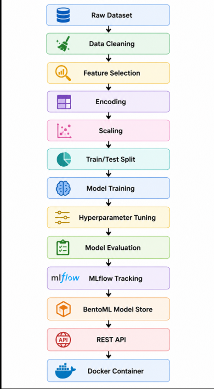

<h1 align="center">
Student Dropout Prediction
</h1>

<p align="center">
A production-oriented Machine Learning project that predicts whether a student is likely to <b>Graduate</b>, <b>Dropout</b>, or remain <b>Enrolled</b> using academic performance, demographic characteristics, and socioeconomic factors.
</p>

<p align="center">


</p>

---

## Overview

Student dropout is a major challenge faced by educational institutions. Detecting students who are at risk early enables universities to provide timely academic support, improve retention rates, and make better data-driven decisions.

This repository demonstrates how a Machine Learning model can be taken beyond experimentation into a deployment-ready application. The project covers the complete lifecycle of an ML solution—from raw data preprocessing to model serving—using modern MLOps practices.

Unlike a traditional notebook-based project, every stage of the workflow has been modularized, tracked, versioned, and prepared for deployment.

---

## Key Highlights

- End-to-end Machine Learning pipeline
- Modular project architecture
- Centralized feature management
- Multiple baseline model comparison
- Hyperparameter tuning using GridSearchCV
- Experiment tracking with MLflow
- Model serialization using Joblib
- REST API deployment with BentoML
- Docker containerization
- Interactive API documentation (Swagger/OpenAPI)

---

## Project Objectives

The primary objective of this project is to build a deployment-ready machine learning system capable of predicting student academic outcomes.

The project focuses on three major aspects:

- Building an accurate prediction model.
- Following software engineering best practices for maintainability.
- Demonstrating an end-to-end MLOps workflow suitable for production environments.

The final model predicts one of the following academic outcomes:

| Prediction Classes |
|--------------------|
| Graduate |
| Dropout |
| Enrolled |

---

# System Architecture

The following architecture illustrates the complete workflow implemented in this project.

<p align="center">

</p>

The pipeline follows a modular approach where each stage is isolated into its own component.

```
Raw Dataset
      │
      ▼
Data Cleaning
      │
      ▼
Feature Selection
      │
      ▼
Preprocessing
      │
      ▼
Train-Test Split
      │
      ▼
Model Training
      │
      ▼
Hyperparameter Tuning
      │
      ▼
Model Evaluation
      │
      ▼
MLflow Tracking
      │
      ▼
BentoML Model Store
      │
      ▼
REST API
      │
      ▼
Docker Container
```

This separation allows each stage of the pipeline to be developed, tested, and maintained independently while improving readability and scalability.

---

# Project Features

The project has been designed as a complete Machine Learning workflow rather than a standalone prediction model.

| Feature | Description |
|----------|-------------|
| Data Preprocessing | Handles feature preparation before training |
| Feature Selection | Uses the final optimized feature subset |
| Model Comparison | Trains and compares multiple ML algorithms |
| Hyperparameter Tuning | Optimizes Random Forest using GridSearchCV |
| Cross Validation | Evaluates model robustness |
| MLflow Integration | Tracks experiments, metrics, and parameters |
| Model Serialization | Saves trained models and preprocessing pipeline |
| BentoML Deployment | Serves the trained model as a REST API |
| Docker Support | Deploys the complete application inside a container |

---

# Technology Stack

<p align="center">


</p>

| Technology | Purpose |
|------------|---------|
| Python | Core programming language |
| Scikit-learn | Model training, preprocessing, evaluation, and hyperparameter tuning |
| Pandas | Data loading and preprocessing |
| NumPy | Numerical computations |
| MLflow | Experiment tracking and model management |
| BentoML | Model serving through REST APIs |
| Docker | Containerization and deployment |
| Joblib | Model serialization |
| Git & GitHub | Version control and collaboration |

---